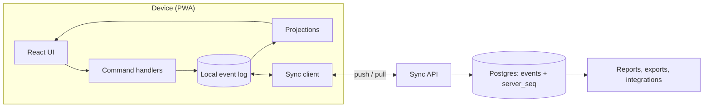
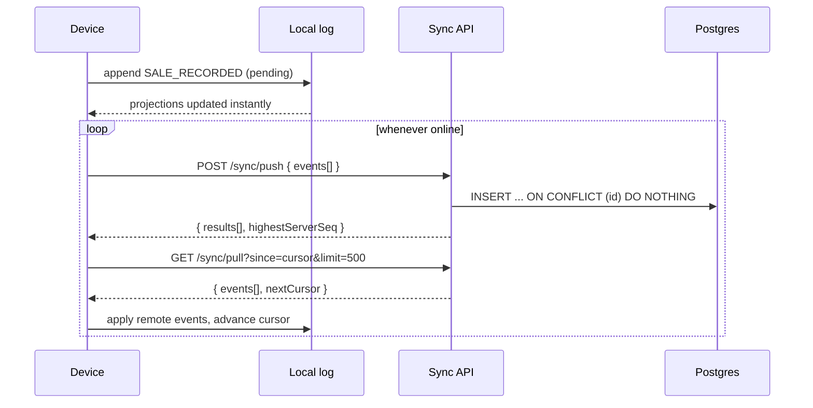

# Architecture

This document records the decisions that are expensive to reverse. Update it whenever one changes, and add a dated entry to the [decision log](#decision-log).

## 1. Goals and non-goals

**Goals**

- Every till keeps selling with no network and no power-stable server.
- Devices converge to identical state after syncing, regardless of order or delay.
- Numbers are auditable: any figure can be traced to the events that produced it.
- A small shop works on one cheap Android phone; a chain works across branches.

**Non-goals (for now)**

- Real-time collaborative editing of the same record.
- Accounting-grade general ledger. We export to accounting tools instead.
- Native apps. The PWA is the product until proven insufficient.

## 2. Core idea: event-sourced, local-first

The device is the source of truth. The server is a relay and long-term archive.

- **Events** are immutable facts, appended to a local log: `SALE_RECORDED`, `STOCK_RECEIVED`, `PAYMENT_RECEIVED`, ...
- **Projections** (stock levels, balances, daily totals) are derived by folding events.
- **Sync** exchanges events, never state.
- **Corrections** are new events (`SALE_VOIDED`, `STOCK_ADJUSTED`). Nothing is edited or deleted.

This removes the classic lost-update bug. Two tills that each sell one unit do not both write `stock = 5`; they append `-1` and `-1`, and every device computes 3.

## 3. System overview



## 4. Event envelope

```ts
type Event = {
  id: string; // UUIDv7. Globally unique. The idempotency key.
  orgId: string;
  branchId: string;
  deviceId: string;
  seq: number; // per-device monotonic counter
  hlc: string; // hybrid logical clock, lexicographically sortable
  type: EventType;
  schemaV: number; // payload version
  payload: unknown; // validated by the zod schema for (type, schemaV)
  createdAt: number; // device wall clock. Informational only, never for ordering
};
```

Rules:

1. **Server dedupes on `id`.** Replaying any push is safe.
2. **Order by `(hlc, deviceId, seq)`.** Never by wall clock; cheap phones have wrong clocks.
3. **Payloads are versioned.** Old events are upcast on read, never rewritten.
4. **Validation happens at both ends.** The server rejects malformed events with a per-event error, not a failed batch.

### Event types (initial)

| Type                                              | Purpose                                                    |
| ------------------------------------------------- | ---------------------------------------------------------- |
| `PRODUCT_UPSERTED`                                | Create or edit a product (name, barcode, price, unit)      |
| `STOCK_RECEIVED`                                  | Goods in from a supplier                                   |
| `STOCK_ADJUSTED`                                  | Count correction, damage, expiry. Requires a reason        |
| `SALE_RECORDED`                                   | Completed sale with lines, tender split, optional customer |
| `SALE_VOIDED`                                     | Reverses a sale by reference. Never deletes it             |
| `PAYMENT_RECEIVED`                                | Customer credit repayment                                  |
| `STOCK_TRANSFER_SENT` / `STOCK_TRANSFER_RECEIVED` | Two-event handshake between branches                       |
| `DAY_CLOSED`                                      | End-of-day cash-up with counted vs expected cash           |

## 5. Hybrid logical clock

An HLC combines wall time with a logical counter so causally related events always sort correctly even when device clocks drift.

- Format: `{wallMs:13 digits}-{counter:4 hex}-{deviceId}`. String comparison equals chronological comparison.
- On local event: `wall = max(now, last.wall)`; if equal to last, increment counter.
- On receiving a remote event: advance local HLC to `max(local, remote)` and increment.
- **Drift guard:** if a remote HLC is more than a configured bound ahead of local wall time, accept the event but flag the device for a clock warning in the UI. Do not let one bad phone push every clock into the future.

## 6. Projections

A projection is a pure function: `(state, event) -> state`.

**Invariant: projections are commutative for the fields they own.** Applying the same set of events in any order must yield the same state. Two mechanisms make that true:

- **Additive data** (stock, balances, totals) is a sum of deltas. Order does not matter.
- **Last-writer-wins data** (product name, price) stores the HLC of the last write per field and applies an incoming change only if its HLC is greater.

Stock is computed from a `stock_movements` view (`SUM(qty_delta) GROUP BY product, branch`), with periodic snapshots to keep reads fast. Snapshots carry the HLC watermark they include, so replay resumes from there.

## 7. Sync protocol



- **Two orderings, two purposes.** `server_seq` (a `bigserial` assigned on ingest) is the **pull cursor**: it is gap-free to the client's perspective and cheap to page. `hlc` is the **logical order** used by projections. Never mix them.
- **Push** is batched and idempotent. Each event gets its own result (`accepted`, `duplicate`, `rejected` with reason).
- **Pull** returns events from other devices only, paged, resumable from the cursor.
- **Retries** use exponential backoff with jitter. Everything is safe to repeat.
- **Pending count** (`events not yet acknowledged`) drives the sync indicator.

## 8. Conflict policy

| Situation                             | Resolution                                                                                                                    |
| ------------------------------------- | ----------------------------------------------------------------------------------------------------------------------------- |
| Two tills sell the last unit          | Both sales stand. Stock goes negative and a **reconciliation flag** is raised for the manager. Never reject a completed sale. |
| Same product edited on two devices    | Field-level last-writer-wins by HLC                                                                                           |
| Void arrives before the sale it voids | Hold the void as pending-reference; apply when the sale arrives                                                               |
| Credit payment arrives out of order   | Balance is a sum, so order is irrelevant                                                                                      |
| Device offline for days               | Batched push, resumable pull, incremental projection                                                                          |
| Transfer sent but never received      | Shows as "in transit" stock until received or cancelled by event                                                              |

## 9. Identifiers that must work offline

- **Event and entity IDs:** UUIDv7, generated on the device.
- **Receipt numbers:** `{branchCode}-{deviceCode}-{perDeviceCounter}` (for example `ABJ1-D3-000142`). Globally unique with no coordination, and human-readable at the counter.
- **Never** use auto-increment IDs on the client.

## 10. Money and quantities

- Money is **integer kobo**. No floats anywhere in the stack, including JSON.
- Quantities are **integer milli-units** (1000 = 1 unit) so weighed goods work without floats.
- Rounding happens in exactly one place: line total computation, with a documented rule.

## 11. Local storage

`EventStore` is the seam between the app and the database:

```ts
interface EventStore {
  append(e: Event): Promise<void>;
  appendRemote(es: Event[]): Promise<void>; // dedupes by id
  since(cursor: string, limit: number): Promise<Event[]>;
  pending(limit: number): Promise<Event[]>; // not yet acknowledged
  markAcked(ids: string[], serverSeq: number): Promise<void>;
  project<T>(name: string): Promise<T>;
}
```

Adapters: `memory` (tests, simulator), `dexie` (IndexedDB, ship first), `sqlite-wasm` (OPFS, real queries). SQLite-WASM with OPFS needs a **single owner**: run it in a dedicated or shared worker so multiple tabs never open the database concurrently.

## 12. Backend

- Fastify service, stateless, horizontally scalable.
- Postgres tables: `events` (primary key `id`, indexed on `(org_id, server_seq)`), `devices`, `branches`, `orgs`, `memberships`.
- Device registration issues a device token; every push and pull is authenticated per device and scoped to an org.
- Row-level security (or equivalent query scoping) is enforced and **tested**: a script authenticates as org A and asserts it cannot read org B.

## 13. Security

- Till PIN lock and idle timeout.
- Roles: owner, manager, cashier. Voids, adjustments and price changes require manager or above, enforced at command handlers locally and re-checked on the server.
- Encrypt sensitive local data at rest where the platform allows it.
- One-tap encrypted backup/export from day one.
- Secrets live in environment variables; only `.env.example` is committed.

## 14. Testing strategy

The most important test in the repository is the **convergence simulator** (`packages/sim`):

1. Generate N devices (3 to 10) with seeded RNG.
2. Interleave random commands (sales, receipts, edits, voids) with random offline periods and message reordering/duplication.
3. Sync everything at the end.
4. Assert all devices have **identical projections** and that no event was lost or double-applied.

Run it across thousands of seeds in CI. Any failing seed is committed as a regression fixture. Additional layers: unit tests for the HLC and each projection, contract tests for the sync API, and RLS isolation tests.

## 15. Risks and mitigations

| Risk                               | Mitigation                                                         |
| ---------------------------------- | ------------------------------------------------------------------ |
| Browser evicts local data          | `navigator.storage.persist()`, backup/export, sync early and often |
| Multiple tabs corrupt the DB       | Single worker owns the database; Web Locks for leader election     |
| Event log grows unbounded          | Snapshots plus compaction, designed in Phase 2                     |
| Wrong device clock                 | HLC plus drift guard and UI warning                                |
| Schema evolution breaks old events | Versioned payloads with upcasters, tested against fixture logs     |
| Cashier fraud (voids, adjustments) | Reason codes, role checks, audit report of voids and adjustments   |

## 16. Decision log

| Date       | Decision                                           | Reason                                                                            |
| ---------- | -------------------------------------------------- | --------------------------------------------------------------------------------- |
| 2026-10-18 | Event-sourced, local-first model                   | Eliminates lost-update bugs; offline is the default case                          |
| 2026-10-18 | Dexie first, SQLite-WASM behind the same interface | Ship sooner; keep the option for real SQL                                         |
| 2026-10-18 | Integer kobo and milli-units                       | No float errors in money or weighed goods                                         |
| 2026-10-18 | Product named Ndekọ (Igbo: record, register)       | The name describes the event log at the core of the design                        |
| 2026-10-18 | `server_seq` for cursors, `hlc` for logical order  | Keeps paging simple and ordering correct                                          |
| 2026-10-20 | Local projection cursor is arrival order, not HLC  | A late remote event with an old HLC would be skipped by an HLC snapshot watermark |
| 2026-10-20 | `EventStore` is a pure log; no `project()` method  | Projections are folds in `@ndeko/core`; keeps adapters thin                       |
| 2026-10-20 | Concrete projections live in `@ndeko/projections`  | They need payload types from schemas, which depend on core                        |
| 2026-10-20 | Reconciliation flags are derived from state        | Stored flags would be order-dependent; derived ones self-clear                    |
| 2026-10-20 | Add `CUSTOMER_UPSERTED` event                      | Enables offline-first customer profiles & credit limits via pure LWW projections  |
